# LIMINAL WORLDS

*Somewhere between geometry and memory.*

Liminal Worlds is an open-source, first-person exploration of impossible
architecture that runs in the browser. You walk through five procedurally built
environments: a brutalist cathedral standing in an endless shallow sea, stairs
that bring you back to where you started, a city of black glass, a house that is
larger inside than out, and a bridge of colossal arches running toward a sunset
that never ends.

There's no combat, no inventory and no quest chain. The architecture is the
whole point.

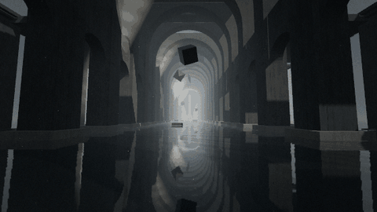

> Every image in this README was captured from the running project with
> `scripts/capture.mjs`, which uses headless Chromium with SwiftShader (software
> WebGL). On a real GPU the same scenes render with more detail. None of the
> images are mock-ups.

| | |
|---|---|
| 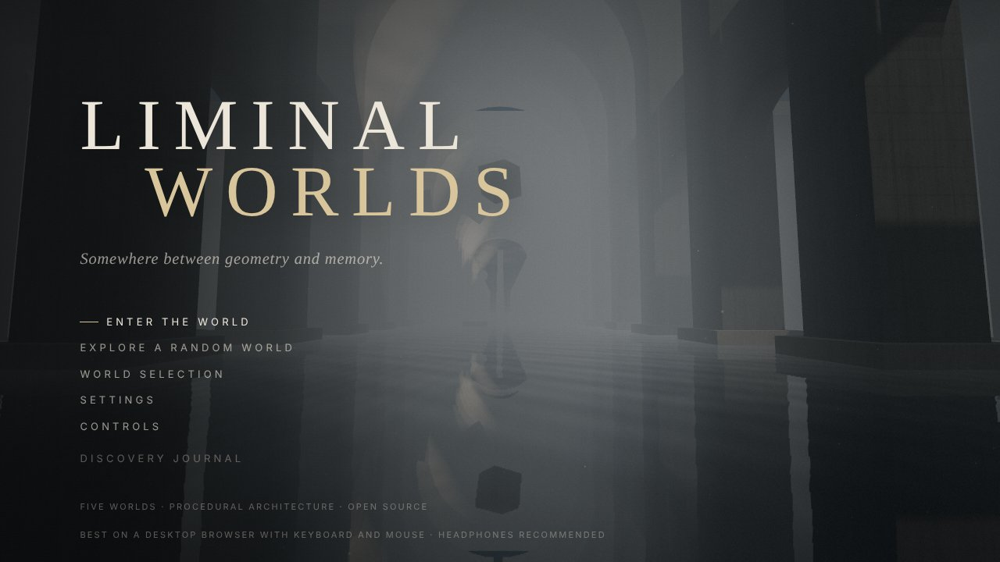 | 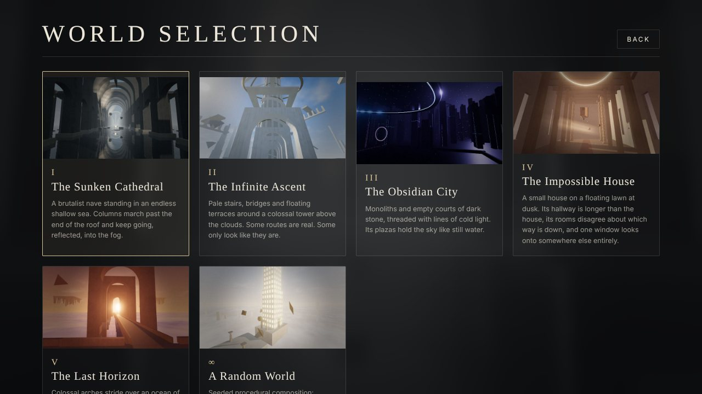 |
| 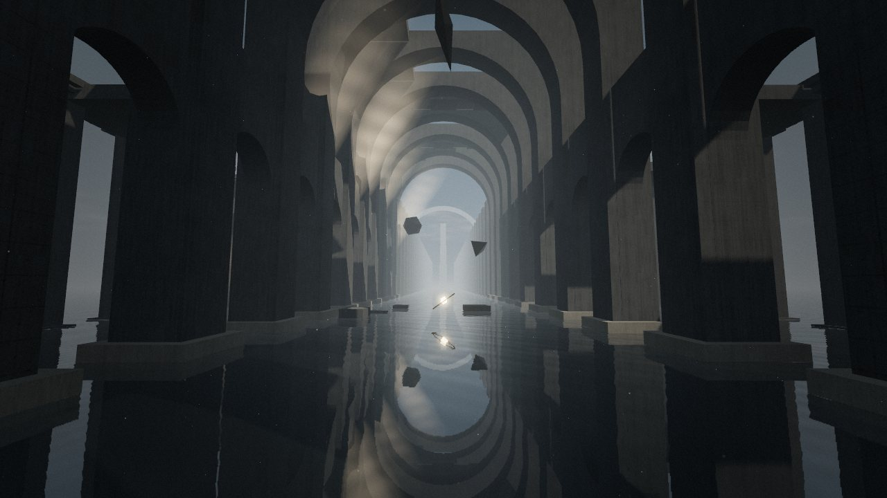 | 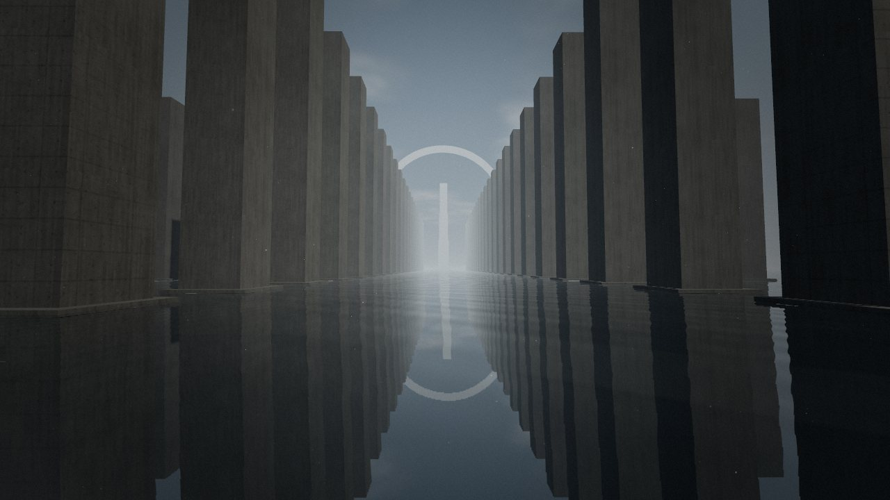 |
| 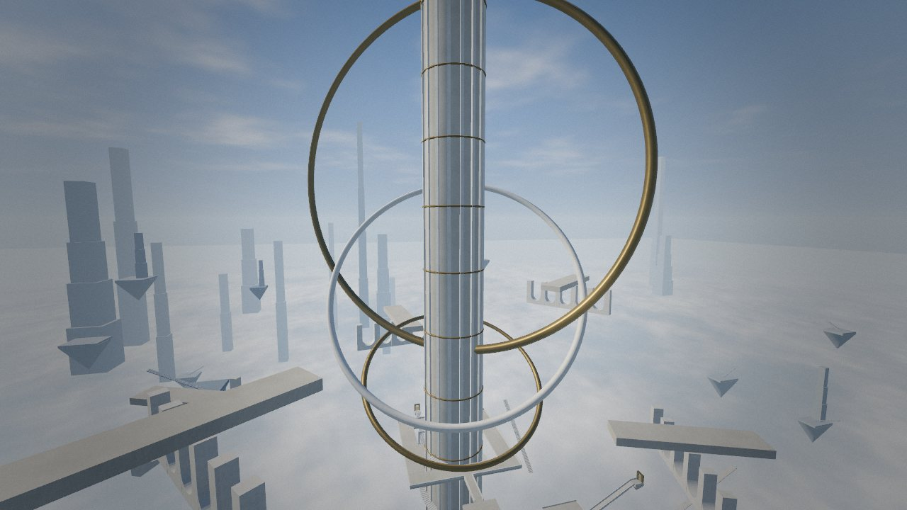 | 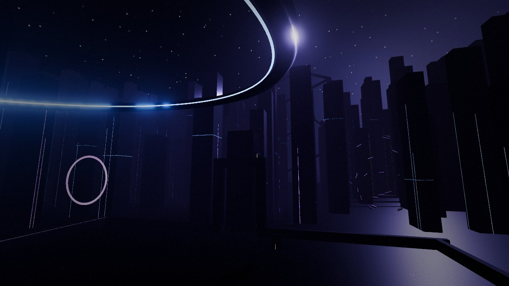 |
| 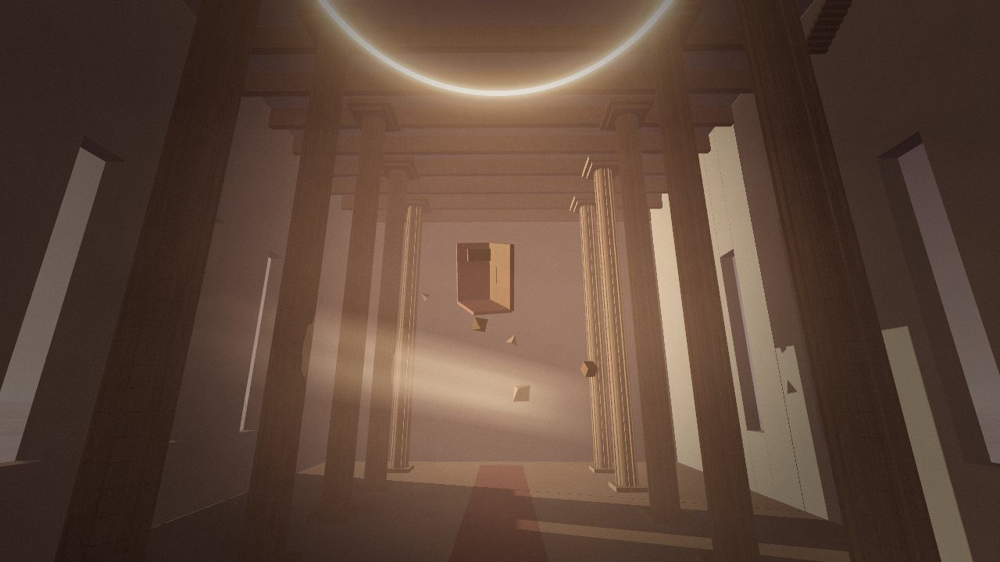 | 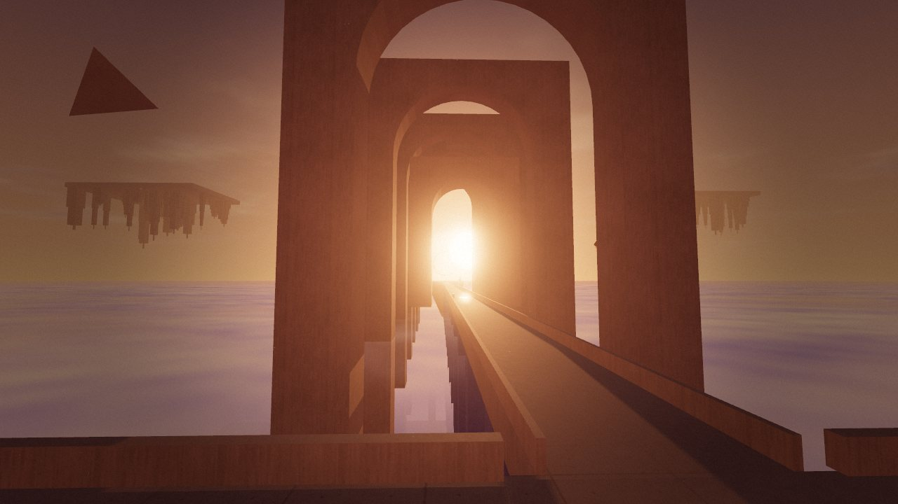 |
| 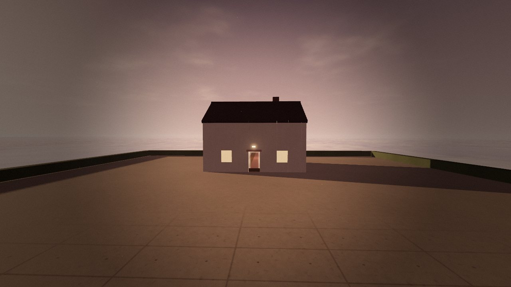 | 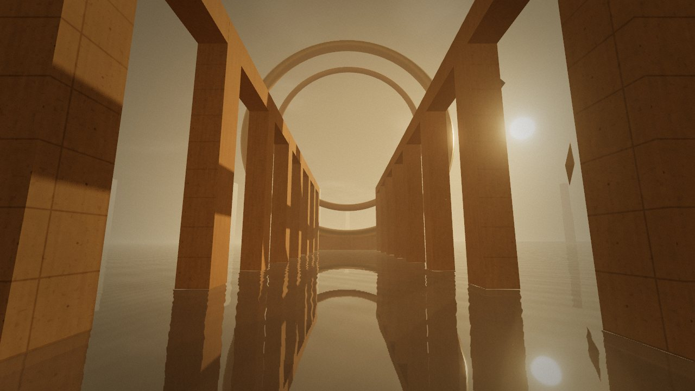 |

More captures are in [`docs/screenshots`](docs/screenshots).

---

## Features

All of the following are implemented and run in the current build:

- **Five distinct worlds**, each with its own architecture, palette, lighting, fog, soundscape and cinematic camera paths:
  1. **The Sunken Cathedral.** A 240 m brutalist nave in shallow reflective water, with a broken vault, shafts of sunlight, floating sculptures and columns that keep marching past the end of the roof into the fog.
  2. **The Infinite Ascent.** Pale stairs, bridges and floating terraces around a 560 m tower, with rotating rings, upside-down aqueducts, a stair that loops back to its own base, and an arch that leads to an inverted district.
  3. **The Obsidian City.** Black-glass plazas that mirror the sky, monoliths threaded with lines of light, a suspended ring, a luminous pool, an anamorphic sculpture that only resolves from one spot, and a giant rotating frame on the horizon.
  4. **The Impossible House.** A small house on a floating lawn at dusk. Inside: a 30 m hallway, a door that opens into a cathedral-sized hall, a room that is turned 90°, a window that opens onto a different sunset, and an attic stair that leads to the cellar.
  5. **The Last Horizon.** A sunset above an ocean of clouds, colossal arches over a long bridge, inverted cities hanging in the sky, and an observation platform where the camera pulls back to reveal a megastructure rising out of the clouds.
- **Seeded random worlds.** Six palettes, four layout patterns (processional, radial, terraced, archipelago) and three kinds of ground, composed into a foreground, middle ground and background. The same seed always builds the same world.
- **A procedural architecture engine** (`src/architecture`). Parametric generators for pillars, colonnades, arches and arcades, straight and spiral staircases, bridges, towers and facades, hanging towers, rooms with real door and window openings, corridors, platforms, rings, doorframes and sculptures. Everything is batched into instanced meshes, and colliders are generated automatically.
- **Rendered portals.** Each portal draws a live view of its destination, rendered from a virtual camera with an oblique near-plane clip. Walking through one keeps your relative position and direction. Portals can also roll the destination to change the direction of gravity, which then rights itself smoothly. Portals between worlds use a veil and a camera-space transition.
- **First-person movement** with pointer lock, configurable sensitivity, gravity, jumping, sprinting, stepping up and down stairs, AABB collision, and recovery after a fall. Pausing, resuming, losing window focus and resizing are all handled.
- **A cinematic camera.** Centripetal Catmull-Rom splines with eased speed and soft dips between shots. It drives the title sequence, an optional tour of each world (G), and scripted moments such as the horizon reveal.
- **Lighting and materials.** ACES filmic tone mapping, sRGB output, a sun that casts shadows and follows the player, hemisphere light, image-based lighting baked from each sky, exponential fog, and world-space triplanar procedural concrete with formwork joints, tie holes, pores and weathering streaks. Also planar-reflection water and black glass, additive light shafts, cloud seas, selective bloom, vignette and grain.
- **Signature set pieces.** The narrow corridor that opens into the nave (impossible reveal), the stair that returns and the inverted arch (architectural contradiction), and the observation platform where a megastructure rises from the clouds (horizon reveal).
- **16 discoveries** across the five worlds, saved in `localStorage` and listed in an optional journal. Each one changes the world, plays a sound or reveals something.
- **Procedural audio** with the Web Audio API. Each world has its own mix of wind and water noise, detuned drones, inharmonic bells, low pulses and a generated reverb. Hum sources fade with distance, soundscapes crossfade between worlds, and there's a master volume and mute. No audio files are used.
- **Photography mode** (P). The interface hides and you can fly the camera freely or orbit a point. You can change the field of view and exposure, add depth of field, and pick one of four lighting presets. It also has a freeze-time toggle and a gallery of this session's captures. Captures are exported as PNG from the final post-processed frame.
- **Interface.** An animated 3D title screen, world selection with previews captured in-engine, settings, controls, a discovery journal and a pause menu. The HUD stays minimal (prompts, world name, temporary hints), menus are keyboard-accessible, and there's a reduced-motion option.
- **Three graphics presets** (Performance, Balanced and Cinematic), a capped pixel ratio, and a performance overlay toggled with the backquote key (`` ` ``).

## Running it

You need Node.js 20 or newer (CI uses Node 22) and npm.

```bash
git clone https://github.com/bhr101/liminal-worlds.git
cd liminal-worlds
npm install
npm run dev          # http://localhost:5173
```

| Command | What it does |
|---|---|
| `npm run dev` | Vite dev server with hot reload |
| `npm run build` | Type-check, then build the production bundle into `dist/` |
| `npm run preview` | Serve the production build locally |
| `npm run typecheck` | `tsc --noEmit` |
| `npm test` | Vitest unit tests |
| `npm run smoke [url]` | Playwright end-to-end smoke test against a running server |
| `npm run capture [url]` | Recapture previews, README screenshots and GIF frames (then `python3 scripts/make_gif.py`) |

The smoke and capture scripts use Playwright's Chromium. If it isn't installed,
run `npx playwright install chromium` first.

## Controls

| Input | Action |
|---|---|
| W A S D / arrow keys | Move |
| Mouse | Look (click the view to capture the pointer) |
| Shift | Sprint |
| Space | Jump |
| E | Interact, or step through a portal |
| Esc | Pause and release the pointer |
| F | Fullscreen |
| M | Mute or unmute |
| G | Cinematic camera (move or press G to return) |
| P | Photography mode |
| `` ` `` | Performance overlay |
| Photo mode | Drag to look · WASD fly · Space/C up and down · Enter captures · H hides the panel · P or Esc returns |

## Architecture overview

```
src/
  main.ts                  bootstrap and WebGL availability check
  core/
    Engine.ts              renderer, frame loop, modes (menu/playing/paused/photo/transition),
                           transitions, portal traversal, photo camera, settings application
    InputManager.ts        keyboard polling, actions, pointer lock
    Settings.ts            validated settings persisted in localStorage
    rng.ts                 mulberry32 seeded RNG
  rendering/
    Lighting.ts            sky, fog, sun with player-following shadows, hemisphere light, PMREM environment
    Materials.ts           procedural noise texture, triplanar architectural material, glow material
    PostProcessing.ts      bloom, depth of field, output (tone mapping), grade (vignette, grain, fades, letterbox)
    Sky.ts / Water.ts / Effects.ts   sky dome, planar-reflection water, light shafts, dust, cloud seas
    Quality.ts             graphics presets
  architecture/            procedural generators (Builder, Pillars, Arches, Staircases, Bridges,
                           Towers, Structures, Portals)
  player/                  CollisionSystem (AABB grid), PlayerController
  systems/                 PortalSystem, CinematicCamera, AudioSystem, DiscoverySystem,
                           ScreenshotSystem, PerformanceMonitor
  worlds/                  the five worlds, WorldGenerator (random worlds), WorldKit, registry, discoveries
  ui/                      HUD, Menu (title, pause, world selection, journal, controls), settings, photo panel
```

Each world is a `WorldDefinition` whose `build()` returns a `WorldInstance`: a
scene graph, a collision world, an atmosphere, spawn and arrival points, portals,
discoveries, interactables, triggers, sound emitters and cinematic shots. The
engine treats every world the same way, and only one world is loaded at a time.
Switching worlds disposes the previous one's GPU resources.

## Procedural generation approach

- **Generators, not props.** Generators write primitives into an `ArchBuilder`, which groups them by geometry and material into `InstancedMesh`es and turns solid pieces into axis-aligned collision boxes. A colonnade of 34 columns becomes one instanced draw. Arch geometry is an extruded single-polygon outline, cached per parameter set.
- **World-space materials.** The architectural material samples one tileable 256² noise texture triplanarly in world space. Because of that, a unit cube scaled to 300 m still reads as poured concrete, and generators never need UVs. Formwork joints and tie holes come from world position and fade out with distance using `fwidth` to avoid aliasing.
- **Seeded and deterministic.** Each world takes a seed (the hand-built worlds use fixed seeds), and `RNG.fork()` gives independent streams to subsystems such as skylines and anamorphic fragments.
- **Composition before scatter.** Random worlds pick a layout that controls the foreground (a spawn platform and a route), the middle ground (colonnades, arcades, terraces, islands, spokes) and a monument at the end of the axis. Skylines and floating forms are added as background, so nothing is scattered at random across an empty plane.
- **Anamorphosis.** The Obsidian City's shifting monolith places 30 fragments along rays from a single viewpoint. Each is scaled by its distance so the pieces line up into a perfect ring only from that marked stone.

## Rendering and performance trade-offs

| Technique | Why |
|---|---|
| Planar reflections (one extra render), not SSR or cube maps | Gives correct mirror reflections for the cathedral water and obsidian plazas. The render target is ¼, ½ or ¾ of screen size depending on the preset. |
| Rendered portals capped at 2 per frame, within 90 m and inside the view frustum | Each portal is a full scene render. Portals beyond that cap, or out of view, cost nothing. |
| Oblique near-plane clipping | Lets portal views be rendered without stencil buffers or recursion. |
| Additive cylinder light shafts and a layered fBm cloud sea | Volumetric-looking light and clouds without ray marching. |
| One shadow-casting sun that follows the player, snapped to shadow texels | Stable shadows over very large worlds. Shadow-map size depends on the preset (1024, 2048 or 4096). |
| Environment map baked once per world from the sky shader | Believable reflections on glass and metal with no per-frame cost. |
| Pixel ratio capped (1, 1.5 or 2) and MSAA off, ×2 or ×4 by preset; bloom off in Performance | The biggest levers for integrated GPUs. |
| AABB collision on a uniform grid | Thousands of boxes are queried in microseconds. Stairs are rows of boxes, and you step up anything under 0.55 m. |

**Frame rate has not been measured on real GPUs.** The development environment
only had software rendering (SwiftShader), where the heaviest worlds run at a few
frames per second at 640×360, so no frame-rate claims are made here. The
performance overlay (`` ` ``) shows your live frame rate, frame time, draw calls
and renderer, so you can judge on your own hardware. If your machine struggles,
use the **Performance** preset.

## Browser compatibility

- This is designed for current desktop Chrome, Edge, Firefox and Safari with WebGL 2. Development and automated testing used Chromium only, so the other browsers are untested.
- Mouse look needs the Pointer Lock API. Without it, keyboard movement still works.
- Audio starts after your first click, because browsers block autoplay.
- **Touch navigation isn't implemented.** On phones and tablets, the title sequence and menus work, but exploring needs a keyboard and mouse.
- If WebGL is unavailable or fails to start, an explanatory message is shown instead of a blank page.

## Testing

| What | How | Status |
|---|---|---|
| Type safety | `npm run typecheck` (strict TypeScript) | Passes |
| Unit tests | `npm test`: 26 Vitest tests covering the RNG, settings validation and persistence, collision, player stair-climbing and wall-blocking and fall recovery, portal transforms (including roll), instanced batching, random-world determinism, cinematic easing and discovery persistence | Pass |
| End-to-end | `npm run smoke`: 42 checks in headless Chromium covering menus, world selection, entering a world, movement, wall collision, pause and resume, mute persistence, rendered portals (chapel, looping stair, inverted arch with gravity roll, turned room), the E-activated window portal, a cross-world portal, fall recovery, cinematic toggle, photo mode PNG download, random-seed reproducibility, all five worlds loading, settings and discovery persistence after reload, and no page errors or failed requests | 42/42 passed on the dev server |
| Production build | `npm run build` | Passes |
| Sub-path hosting | The built `dist/` was served under `/liminal-worlds/` and loaded without errors | Passed locally |

**Not verified:** performance on real GPUs, browsers other than Chromium, how the
audio actually sounds (headless test runs have no speakers; the audio graph was
only checked for errors), and the live GitHub Pages deployment (see below).

## Deploying to GitHub Pages

`vite.config.ts` uses `base: './'`, so the build works from any sub-path,
including `https://<user>.github.io/liminal-worlds/`. The workflow in
`.github/workflows/pages.yml` builds and deploys whenever you push to `main`.

To turn it on:

1. Push the repository to GitHub, with `main` as the default branch.
2. Go to **Settings → Pages → Build and deployment → Source** and choose **GitHub Actions**.
3. Push to `main`, or run the **Deploy to GitHub Pages** workflow by hand. The URL appears in the workflow summary.

`.github/workflows/ci.yml` runs the type-check, unit tests and production build
on every push and pull request.

## Known limitations

- Collision uses axis-aligned boxes. Rotated decorative elements (the parapets of diagonal stairs, the sculptures) don't collide, and the tower's round core collides as an inscribed square.
- Gravity changes are presented through portal roll: the camera arrives tilted and rights itself. There's no continuous walking on walls or ceilings.
- Portals don't render recursively. While a portal view is rendered, other portal surfaces are hidden, so a portal seen through another portal shows the space behind it.
- Portals between worlds use a fade-through transition, not a live view of the other world. Only one world is in memory at a time.
- Random worlds have no portals or discoveries of their own.
- Changing the graphics preset updates pixel ratio, MSAA, bloom and shadows straight away. Reflection resolution, particle count and cloud detail update when the next world loads.
- The photo gallery only lasts for the current session. Captures are saved through your browser's normal download flow.

## Roadmap (not implemented)

- Touch and gamepad navigation
- Recursive portal rendering, and live views between worlds
- Continuous surface-aligned gravity in the Impossible House
- More layout grammars and portal pairs in the random-world generator
- Measured performance budgets on a range of integrated and discrete GPUs
- Localisation of the interface text

## License

[MIT](LICENSE). All geometry, textures and audio are generated at runtime, so
there are no third-party art or sound assets. Runtime dependency: [three.js](https://threejs.org) (MIT).
